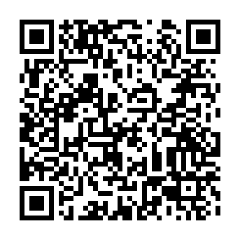
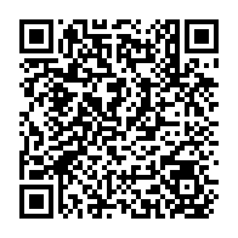

<div align="center">


# NotchTasks

**Your AI agents, in the notch.**

[Website](https://notchtasks.web.app) · [Download for macOS](https://notchtasks.web.app/assets/NotchTasks.dmg) · [Download for Windows](https://notchtasks.web.app/assets/NotchTasks-Setup.exe) · [iPhone](https://apps.apple.com/us/app/notchtasks-ai-agent-remote/id6831539007) · [Android](https://play.google.com/store/apps/details?id=com.notchtasks.android)


<sub>macOS: grows out of the notch</sub>


<sub>Windows 10 and 11: a floating pill at the top of the screen</sub>

</div>

## Features

- **Answer your agents**: allow, deny or pick an answer when Claude Code, Codex, Gemini CLI, Antigravity, Cursor or OpenCode stops to ask. Codex desktop and CLI sessions show while they run.
- **AI plan limits**: Claude's and Codex's 5-hour and weekly usage, on the notch and on your phone. Turn on Claude's once; NotchTasks sets up Claude Code for you.
- **Builds and CI**: Xcode, Gradle, npm, Flutter, GitHub Actions and more, with one line when they finish or fail.
- **Now playing, devices and battery**, calendar meetings with a Join button, a focus timer and a file shelf.
- **Made for each system**: native Swift on the Mac; on Windows, a native WPF app with Fluent icons, Mica and light and dark themes.
- **38 animated pixel icons**, themes and colours.
- **Phone companion**: pair once by QR code and answer from the Lock Screen. Direct on the same Wi‑Fi, end-to-end encrypted elsewhere.
- **Private**: no account, 16 languages.

## Install

**Windows 10/11** (x64), in PowerShell:

```powershell
irm https://notchtasks.web.app/install.ps1 | iex
```

It downloads the latest installer, checks its SHA-256 against the published one, installs it for your user only (no
administrator rights) and opens NotchTasks. Or [download the installer](https://notchtasks.web.app/assets/NotchTasks-Setup.exe).
It is not code-signed yet, so if Windows protects your PC, choose **More info → Run anyway**.

**macOS 14 or later**, in Terminal:

```sh
curl -fsSL https://notchtasks.web.app/install.sh | bash
```

Linux is paused for now.

## Phone app

Answer your agents and see your limits from your phone. Pair it from **Pairing** in the NotchTasks settings.

<table>
<tr>
<td align="center"><a href="https://apps.apple.com/us/app/notchtasks-ai-agent-remote/id6831539007"></a><br /><a href="https://apps.apple.com/us/app/notchtasks-ai-agent-remote/id6831539007"><b>iPhone · App Store</b></a></td>
<td align="center"><a href="https://play.google.com/store/apps/details?id=com.notchtasks.android"></a><br /><a href="https://play.google.com/store/apps/details?id=com.notchtasks.android"><b>Android · Google Play</b></a></td>
</tr>
</table>

## Build

```sh
mac/build.sh                         # macOS app → mac/build/NotchTasks.app
pwsh windows/installer/build.ps1     # Windows installer (needs .NET 10 SDK and Inno Setup 6) → windows/installer/out/
dotnet test windows/NotchTasks.sln   # Windows tests
```

`mac/` is the Mac app (Swift, AppKit + SwiftUI), `windows/` is the Windows app (C#, WPF on .NET 10), and `l10n/` holds the
translations (`python3 l10n/build.py` after editing a table). `electron/` is the paused Linux app. Releasing on Windows is
described in [windows/installer/README.md](windows/installer/README.md).

## License

Not chosen yet: all rights reserved for now. The NotchTasks name and icon are not part of any code license.
