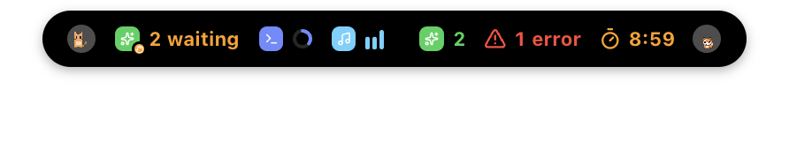
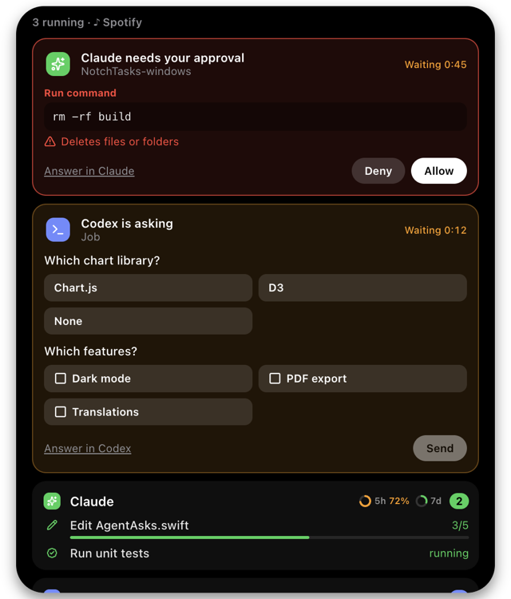
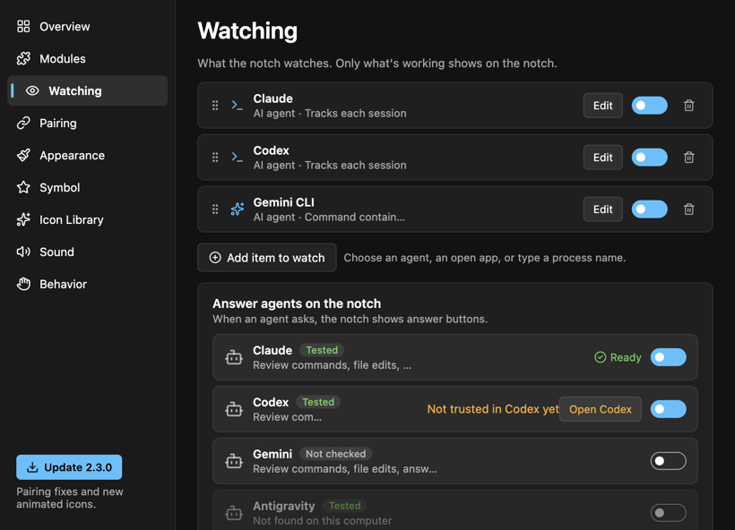
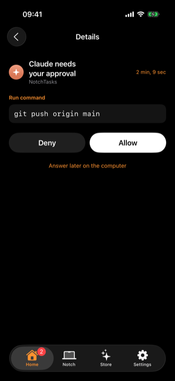

<div align="center">


# NotchTasks

**Your AI agents, in the notch.**

NotchTasks puts every running coding agent and build at the top of your screen.
When an agent stops to ask, you allow or deny it right there, or from your phone.

[Website](https://notchtasks.web.app) · [Download for macOS](https://notchtasks.web.app/assets/NotchTasks.dmg) · [Privacy](https://notchtasks.web.app/privacy.html)


<br />



</div>

## What it does

NotchTasks stays quiet until something needs you. On a MacBook it grows out of the notch itself; on a screen without
one, and on Windows, it is a small floating pill at the top centre that behaves the same way.

<table>
<tr>
<td width="52%" valign="top">

</td>
<td valign="top">

**Answer your agents**<br />
See the exact command, file edit or question, then allow, deny or pick an answer. The agent continues the
moment you do.

**Watch builds and CI**<br />
Xcode, Gradle, npm, Flutter, Docker and more are detected on their own, and so are GitHub Actions and GitLab
runners. You get one line when a build finishes or fails.

**Know your limits**<br />
Session and weekly usage of your AI plans, and when they reset.

**Everything else at a glance**<br />
Now playing, connected devices and battery, CPU, memory and temperature, a focus timer, a mirror and a shelf for
files. Each module can be turned off.

**Make it yours**<br />
Themes, colours and 38 animated pixel characters that live on the notch.

</td>
</tr>
</table>

### Works with

| Agent | Shows its work | Answer from the notch |
| --- | :---: | :---: |
| Claude Code | ✓ | ✓ |
| Codex | ✓ | ✓ |
| Gemini CLI | ✓ | ✓ |
| Antigravity | ✓ | ✓ |
| Cursor | ✓ | ✓ |
| OpenCode | ✓ | ✓ |

Answering is one switch per agent in the Control Panel. NotchTasks adds a small hook to that agent's own settings and
keeps a backup of the file it changes. If an agent is set to approve on its own, the notch stays out of the way. With
NotchTasks closed, the hook does nothing and the agent asks in the terminal as usual.

<p align="center">

</p>

## Your phone, too



Pair a phone once by scanning a code. From then on, what the notch shows reaches your phone, and your answer goes
straight back: from the app, a notification or a Live Activity on the Lock Screen.

- **On the same Wi‑Fi** the computer and the phone talk directly. Nothing passes through a server.
- **Away from home** messages are end-to-end encrypted on your devices before they are relayed. The relay cannot
  read them.
- **The pairing code carries the encryption key**, which never leaves your two devices.

The iPhone app is coming to the App Store, and an Android app is in testing. The computer app is free and complete
without a phone.

<br clear="right" />

## Install

**macOS 14 or later.** Paste this in Terminal. It installs NotchTasks into Applications and opens it:

```sh
curl -fsSL https://notchtasks.web.app/install.sh | bash
```

Or [download the disk image](https://notchtasks.web.app/assets/NotchTasks.dmg) and drag the app into Applications.
The app is signed with a Developer ID, notarized by Apple, and keeps itself up to date.

**Windows 10 or 11 (preview).** Build it from source (below). The Windows app is new: it has been developed and
tested on macOS but not yet on a real Windows PC. See
[what is still to verify](windows/README.md#not-verified-without-a-windows-pc).

## Build from source

| | Needs | Command |
| --- | --- | --- |
| macOS app | Xcode 16+ on macOS 14+ | `mac/build.sh` → `mac/build/NotchTasks.app` (`--install` also copies it to Applications) |
| Windows app | Node.js 20+ | `cd windows && npm ci`, then `npm start` to run, `npm test`, or `npm run dist:win` for the installer |

`mac/build.sh` signs with your own Developer ID or Apple Development certificate when it finds one, and ad hoc
otherwise. The macOS app checks itself with `--selftest`.

The Windows app is Electron with plain JavaScript and no UI framework, so it also runs on a Mac during development
(the Windows-only parts stay quiet). Details are in [windows/README.md](windows/README.md).

## Repository layout

```
mac/        macOS app: Swift, AppKit and SwiftUI (NotchTasks.xcodeproj, Sources/, Resources/Sprites/)
windows/    Windows app: Electron (src/core logic and tests, src/main windows and system, src/renderer UI)
l10n/       translations for 16 languages
.github/    CI for the Windows build, and the images in this README
```

Both apps use the same sprites (`mac/Resources/Sprites`) and the same translation tables (`mac/Sources/l10n-*.json`).

## Translations

English is the source language: the code calls `L("English text")`, and every other language is a table in
`l10n/tsv/<code>.<n>.tsv` (`index<TAB>text`, where the index points into `l10n/keys.json`). After editing a table:

```sh
python3 l10n/build.py      # checks placeholders and writes mac/Sources/l10n-<code>.json
```

English, Tiếng Việt, 简体中文, 繁體中文, 日本語, 한국어, Español, Português (Brasil), Français, Deutsch, Italiano, Русский,
Türkçe, Bahasa Indonesia, ภาษาไทย and हिन्दी.

## Privacy

No account and no sign-up. Your commands, file contents and code are never readable by us: on the same Wi‑Fi nothing
leaves your network, and away from it every message is sealed on your devices first. The apps send anonymous usage
statistics (which screens and features are used); you can turn them off in Settings. The full policy is at
[notchtasks.web.app/privacy.html](https://notchtasks.web.app/privacy.html).

## Contributing

Bug reports and pull requests are welcome. For anything bigger than a fix, please open an issue first so we can agree
on the approach. Keep changes small and in the style of the code around them, and run the tests before sending them
(`npm test` in `windows/`, `--selftest` for the macOS app). Translation fixes go in `l10n/tsv/`.

## License

No license has been chosen yet, so all rights are reserved for now. "NotchTasks" and its icon are trademarks of
Hung Nguyen and are not covered by the code license: a fork must use its own name and icon.
