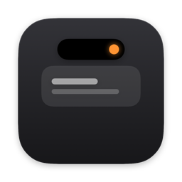

<div align="center">



# NotchTasks

**Your AI agents, in the notch.**

[Website](https://notchtasks.web.app) · [Download for macOS](https://notchtasks.web.app/assets/NotchTasks.dmg) · [Windows](https://notchtasks.web.app/assets/NotchTasks-Setup.exe) · [Linux](https://notchtasks.web.app/#linux)


<sub>macOS: grows out of the notch</sub>


<sub>Windows, Linux, or any screen without a notch: a floating pill</sub>

</div>

## Features

- **Answer your agents**: allow, deny or pick an answer when Claude Code, Codex, Gemini CLI, Antigravity, Cursor or OpenCode stops to ask.
- **Builds and CI**: Xcode, Gradle, npm, Flutter, GitHub Actions and more, with one line when they finish or fail.
- **AI usage limits**, now playing, devices and battery, a focus timer and a file shelf.
- **38 animated pixel icons**, themes and colours.
- **Phone companion**: pair once by QR code and answer from the Lock Screen. Direct on the same Wi‑Fi, end-to-end encrypted elsewhere.
- **Private**: no account, 16 languages.

## Install

macOS 14 or later, and Linux (x64 or arm64, preview):

```sh
curl -fsSL https://notchtasks.web.app/install.sh | bash
```

Windows 10/11 (preview), in PowerShell:

```powershell
irm https://notchtasks.web.app/install.ps1 | iex
```

Or [download the installer](https://notchtasks.web.app/assets/NotchTasks-Setup.exe). It is not code-signed yet, so if
Windows protects your PC, choose **More info → Run anyway**.

On Debian or Ubuntu you can also install the package: [.deb x64](https://notchtasks.web.app/assets/NotchTasks-2.2.0-linux-x64.deb) · [.deb arm64](https://notchtasks.web.app/assets/NotchTasks-2.2.0-linux-arm64.deb).

## Build

```sh
mac/build.sh                                  # macOS app → mac/build/NotchTasks.app
cd electron && npm ci && npm run dist:win     # Windows installer → electron/dist/
cd electron && npm run dist:linux             # Linux tar.gz and deb → electron/dist/
```

`mac/` is Swift (AppKit + SwiftUI), `electron/` is the Windows and Linux app (Electron), and `l10n/` holds the translations
(`python3 l10n/build.py` after editing a table).

## License

Not chosen yet: all rights reserved for now. The NotchTasks name and icon are not part of any code license.
